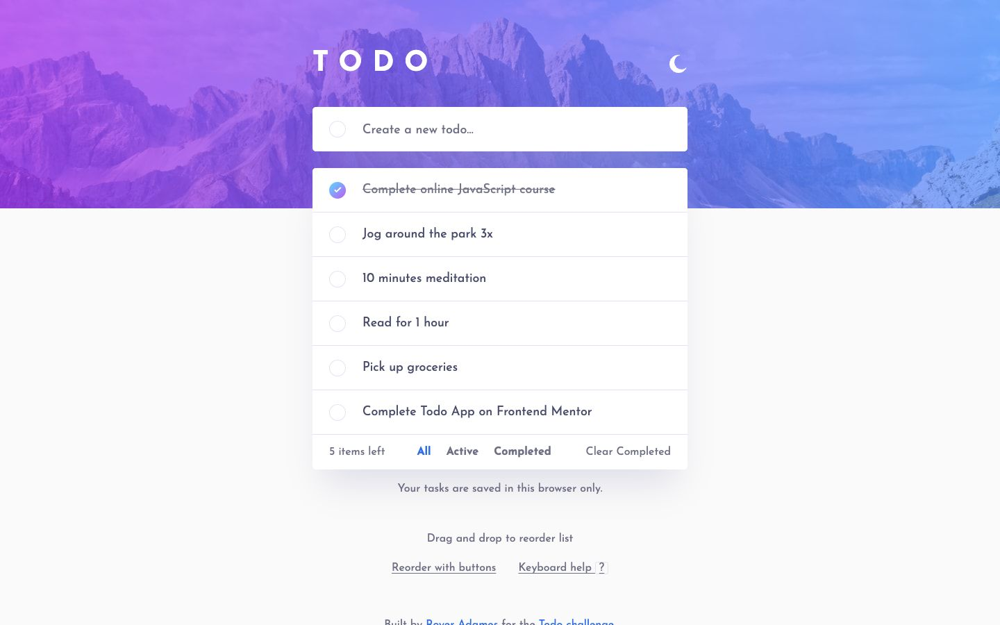

# Frontend Mentor - Todo app solution

This is a solution to the [Todo app challenge on Frontend Mentor](https://www.frontendmentor.io/challenges/todo-app-Su1_KokOW). My app lets you manage a task list saved in your browser, filter and reorder tasks, and switch between light and dark themes.

## Table of contents

- [Overview](#overview)
  - [The challenge](#the-challenge)
  - [Screenshot](#screenshot)
  - [Links](#links)
- [My process](#my-process)
  - [Built with](#built-with)
  - [What I learned](#what-i-learned)
  - [Continued development](#continued-development)
- [Run it locally](#run-it-locally)
- [Author](#author)

## Overview

### The challenge

Users should be able to:

- View a layout that fits their device's screen size.
- See hover states for interactive elements.
- Add new todos to the list.
- Mark todos as complete.
- Delete todos from the list.
- Filter by All, Active and Completed.
- Clear all completed todos.
- Toggle light and dark mode.
- Drag and drop to reorder items on the list, the challenge's bonus.

### Screenshot



### Links

- Solution URL: [My Todo app solution on Frontend Mentor](https://www.frontendmentor.io/solutions/todo-app-with-nextjs-typescript-and-tailwind-C3LK58NzsG)
- Live Site URL: [Todo app](https://todo-app.royeradames.com)

## My process

### Built with

- Next.js App Router
- React
- TypeScript
- Tailwind CSS and custom CSS
- TanStack Form
- Zod Mini for task and stored-data validation
- localStorage for tasks and theme preference
- Playwright for browser and production checks
- Node.js test runner for unit tests

### What I learned

A stale Next.js build cache shipped my previous stylesheet. I learned to clear the cache and check the CSS the site actually serves when a style change does not appear.

The controls below my list jumped down while saved tasks loaded. The server cannot read localStorage, so I show a loading state and hide the content below the list until the browser has loaded the tasks. I added a production check that delays scripts and measures layout shifts.

I cut about 52 KB of gzipped JavaScript by using `zod/mini` with `import * as z`. The namespace import lets the bundler drop schema types I do not use. I kept validation for task commands and saved data, and added a check for imports that bring the larger bundle back.

I finished the drag-and-drop bonus. Touch uses a long press so normal scrolling still works. I also added Alt with the up or down arrow to move a focused task, plus optional move buttons. Moving a task keeps focus on its control.

### Continued development

- I want to show the specific 500-task limit message when the list is full. The model already throws that error, but the form currently shows a generic save error.

## Run it locally

Use Node.js 24.11.1 or newer.

```bash
npm ci
npm run dev   # http://127.0.0.1:4325
```

Tasks stay in localStorage in this browser. The first visit shows the design's sample tasks. If storage fails, changes are temporary and disappear when you reload or close the tab. `setup.json` records that the app needs no settings.

- `npm run typecheck`, `npm run lint`, `npm test`: types, static checks, list and storage unit tests, and the browser-only solution check.
- `npm run test:setup`: checks that the code reads no settings. It also runs as part of `npm test`.
- `npm run test:browser`: checks the list at 320 px, the skip link and keyboard shortcuts on `next dev`. `TODO_TEST_PORT` overrides port 4325.
- `npm run build`, then `npm run test:production`: checks the production list journey, reordering, reload, theme, console errors and loading layout. `TODO_PRODUCTION_TEST_PORT` overrides port 4327.

I used the official `frontendmentorio/todo-app` starter at commit `ab67102eff4ea8c9aa616038660fc811eb72255d`. Its design stills are in `reference/design`, and its images are in `public/images`. I kept the separate mobile filter card and hover-revealed delete buttons. I raised small text to at least 16 px instead of the design's 12–14 px, and adjusted muted, completed and accent colours for 4.5:1 contrast on the card.

Keyboard shortcuts adapt my existing UI guard pattern. N focuses the new-task field, ? opens help and Escape closes it. Drag with a mouse or long-press and drag on touch. Alt with the up or down arrow reorders the focused task. "Reorder with buttons" shows move buttons.

## Author

- Website - [Royer Adames](https://royeradames.com)
- Frontend Mentor - [@royeradames](https://www.frontendmentor.io/profile/royeradames)
